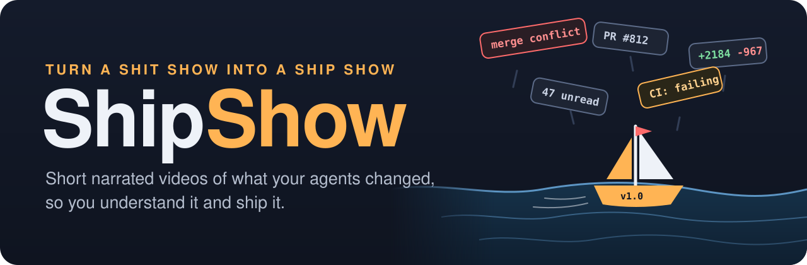
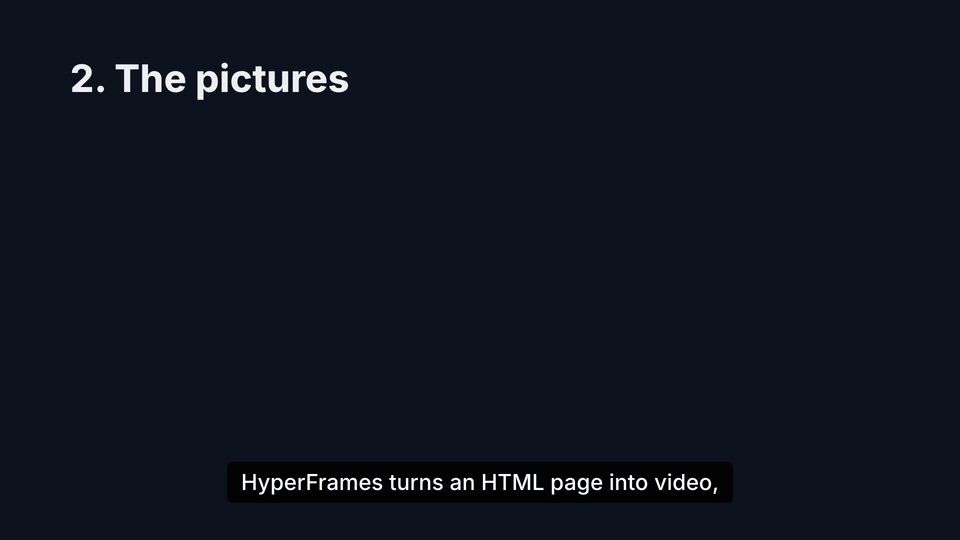
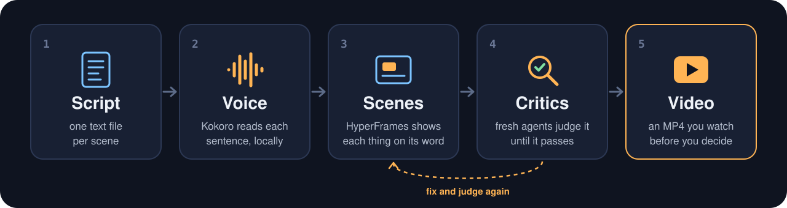
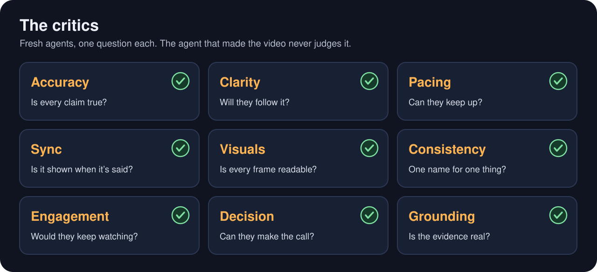

<p align="center">
  
</p>

Your agents change code faster than you can read it. ShipShow hands you a short narrated video of what changed and what you need to decide, so you merge code you understand. It runs on your own machine.

<p align="center">
  
  <br>
  <sub>A word in the script, tagged in the scene, appears as the voice says it. From <a href="videos/how-it-works">our own explainer</a>.</sub>
</p>

<!-- The full how-it-works video goes here. -->

## How it works

<p align="center">
  
  <br>
  <sub>Script &rarr; Voice &rarr; Scenes &rarr; Critics &rarr; Video</sub>
</p>

[Kokoro-82M](https://huggingface.co/hexgrad/Kokoro-82M) does the voice and [HyperFrames](https://hyperframes.heygen.com) draws and records the scenes. Your agent writes the script and the scenes, and a panel of critic agents decides when the video is done.

<p align="center">
  
  <br>
  <sub>Accuracy &middot; Clarity &middot; Pacing &middot; Sync &middot; Visuals &middot; Consistency &middot; Engagement &middot; Decision</sub>
</p>

## Set it up

Node.js 22+, Python 3.10+ and ffmpeg (tested on macOS):

```
npm install
npm run setup
npm run doctor
npm run make -- videos/how-it-works
```

The first run downloads the voice model (about 340 MB) and, if needed, a headless Chrome (about 190 MB). Then ask your agent for one:

> Make me a ShipShow video on the retry logic you just wrote. I need to decide whether to ship it today.

## Make it yours

Tell your agent how you like your videos ("open with the decision", "always show the code") and it keeps that in `local/`, which never leaves your machine. Videos about private code live there too.

## How we work

- **Use it on your own work**, then turn whatever got in the way into a pull request.
- **A bar you keep wishing a video met becomes a critic.**
- **Every change is a pull request**, with CI and an automated review before it merges.

Everything about the code, the skills and the commands is in [AGENTS.md](AGENTS.md).

<sub>Made for the amperium.ai hackathon. MIT licensed. Kokoro-82M and HyperFrames are Apache 2.0; GSAP is under its free <a href="https://gsap.com/standard-license">standard license</a>.</sub>
